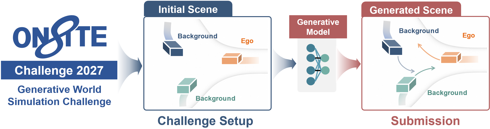

<!-- Horizontal OnSite logo: public/ONSITE-blue-logo-cn_name.svg. -->
<p align="center">
  <a href="https://onsite.com.cn/">
    
  </a>
</p>

<h1 align="center">OnSite Generative World Simulation Challenge</h1>

<p align="center"><a href="./README.md">简体中文</a> · <strong>English</strong></p>

<p align="center">
  <strong>A generative world model challenge for autonomous driving tests</strong>
</p>

<p align="center">
  AI for AI testing. Generate future driving scenarios from past observations and evaluate how well they test driving policies.
</p>

<p align="center">
  <a href="https://onsite.com.cn/">
    
  </a>
  &nbsp;&nbsp;
  <a href="https://nova-chen151.github.io/Onsite3DSG-Benchmark.github.io/">
    
  </a>
  &nbsp;&nbsp;
  <a href="https://nova-chen151.github.io/Onsite3DSG-Benchmark.github.io/#leaderboard">
    
  </a>
  &nbsp;&nbsp;
  <a href="https://github.com/Nova-chen151/Onsite3DSG-Benchmark.github.io">
    
  </a>
</p>

<p align="center">
  <a href="https://nova-chen151.github.io/Onsite3DSG-Benchmark.github.io/#leaderboard"><strong>🏆 View Leaderboard →</strong></a>
</p>

<p align="center">
  <a href="#overview">Overview</a> ·
  <a href="#task">Task</a> ·
  <a href="#evaluation">Evaluation</a> ·
  <a href="#getting-started">Build and publish</a>
</p>

<p align="center">
  <a href="public/overview-en.png">
    
  </a>
</p>

## Overview

**A generated driving scenario should look realistic and provide a trustworthy test of an autonomous driving policy.**

The OnSite 3DSG Benchmark evaluates models for controllable, scalable driving scenario generation and testing. Each model receives the same historical driving context and generates a future scenario. The benchmark then assesses whether that scenario provides meaningful test conditions for autonomous driving algorithms.

The evaluation covers **observation quality**, **scenario fidelity**, **policy response**, and **quality-aware testing effectiveness**. It examines visual quality and traffic dynamics, measures how policies behave in generated scenarios, and checks whether the scenario provides credible evidence of a policy failure.

> **Repository scope.** This repository hosts the project overview, task description, and interactive leaderboard. The full model and evaluation engine implementations are outside its scope. The leaderboard ranks the seven models in the paper’s Table 2 under “Generated trajectories + rendering” by descending QTES. The official submission and evaluation backend is not yet connected.

## Task

### From past observations to future driving scenarios

Each method generates a future scenario from the historical inputs supplied for the task. The benchmark evaluates the generated scenario and uses it to test driving policies.

| Stage | Description |
| --- | --- |
| Historical input | The inputs described on the project page include 10 consecutive frames of historical imagery, camera parameters, the ego vehicle state, and scenario conditions. |
| Future generation | Output the future driving scenario through the common interface. Keep observations from different views and the associated scene information aligned in space and time. |
| Consistency checks | Check continuity at the transition from past to future, missing frames, anomalous values, plausible motion, and consistency with the map. |
| Paired testing | Run the same driving policies on the real and generated scenarios. Compare safety, comfort, route progress, and decisions. |

```text
Historical driving context → Future scenario generation → Layered quality assessment → Paired driving policy tests → Testing effectiveness analysis
```

## Evaluation

### From visual realism to testing effectiveness

The website groups the metrics into four layers. Each answers a different question. A single visual score or an isolated policy failure gives only a partial view.

| Evaluation layer | Question | Metrics shown on the website |
| --- | --- | --- |
| **Observation Quality** | Do the generated observations look credible and remain consistent over time? | FVD ↓, CLIP-IQA+ ↑, DINO-T ↑ |
| **Scenario Fidelity** | Is the geometry consistent across views? Do images agree with the traffic state, and does traffic evolve plausibly? | Epi@3 ↑, TVC ↑, TRS ↑ |
| **Policy Response** | How safely and comfortably does the policy drive in the generated scenario, and how far does it progress along the route? | RPDMS ↑, Route Completion ↑ |
| **Quality-Aware Testing Effectiveness** | Given its quality, can the scenario reliably expose a policy failure? | QTES ↑ |

**Policy performance and the value of a test scenario are assessed separately.** When a policy fails, poor image quality, inconsistent geometry, or implausible traffic behavior may explain the outcome. The evaluation considers these factors when deciding whether the scenario reveals a policy weakness.

The metric names, groups, and directions follow the website’s evaluation guide. The published evaluation protocol governs formal definitions, computation settings, validity criteria, and ranking rules. [Online evaluation guide](https://nova-chen151.github.io/Onsite3DSG-Benchmark.github.io/#evaluation)

## Leaderboard data

The leaderboard covers the **Generated trajectories + rendering** setting. It excludes results that use fixed recorded trajectories and the Real video reference. **2026-09-29** is the date of the source snapshot. Experiment and submission dates are separate. The page displays the visitor’s local date as its snapshot date.

| QTES rank | Model | QTES ↑ |
| --- | --- | --- |
| 1 | OpenDWM | 44.079 |
| 2 | DreamForge | 41.311 |
| 3 | HorizonDrive | 40.108 |
| 4 | MagicDrive-V2 | 39.509 |
| 5 | Panacea | 39.146 |
| 6 | BaseDreamer | 38.522 |
| 7 | MagicDrive | 37.282 |

The nine metrics follow the paper’s four groups: Observation Quality, Scenario Fidelity, Policy Response, and Testing Eff. Values retain their original scales and are displayed to three decimal places. Lower FVD is better. Higher values are better for all other metrics. Coral marks the best value for each metric and blue marks the second best. Ties share a color. The identical TRS values have no highlight. Sorting a column changes the display order. The reported rank always follows QTES.

<a name="getting-started"></a>

The results are maintained in `src/results.js` and the table headers in `src/page.html`. After editing, run `npm run build` and `npm test`. If Chrome is installed, you can also run `npm run test:browser`. Commit the regenerated `index.html` with the changes to update the GitHub Pages site and the downloadable score records.

## Project Status

This repository currently presents the project and its interactive leaderboard. Official operation requires reviewed competition results, authentication, submission and evaluation workflows, and certificate issuance. Competition announcements provide the participation arrangements and official results.

The site retains the original logo and media files. Font licensing details are available in [public/FONT-LICENSES.txt](public/FONT-LICENSES.txt).
